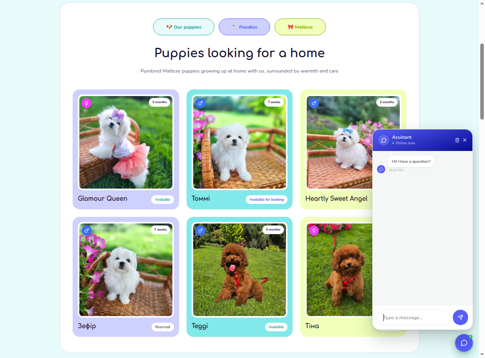

# Laravel AI Chat With Telegram Bot

[](LICENSE)
[](composer.json)
[](composer.json)
[](https://iz-shelkovoi-stai.com.ua/)

A conversational AI chat widget for Laravel applications. Drop it into any page, answer customers with an LLM that can call your own PHP code as tools (look up an order, check stock, search your content), persist full conversation history, and hand off to a human administrator over Telegram when the AI can't help.



**🔗 Live example: [iz-shelkovoi-stai.com.ua](https://iz-shelkovoi-stai.com.ua/) - try the chat widget in the bottom-right corner.**

## Features

- **Drop-in chat widget** - one Blade include, themeable, no JavaScript build step required on the host app.
- **Pluggable LLM provider** - OpenAI and Anthropic supported out of the box; implement one interface to add another.
- **Function-calling tools** - give the LLM access to your own domain logic (product search, order lookup, etc.) instead of letting it guess.
- **Persistent history** - every conversation and message is stored, scoped to a logged-in user or an anonymous visitor cookie.
- **Human handoff via Telegram** - when the AI can't answer, or the customer asks for a person, the conversation switches to a live admin chat over Telegram - no separate helpdesk needed.

## Requirements

- PHP ^8.3
- Laravel ^11.0 | ^12.0 | ^13.0

## Installation

```bash
composer require yu-laravel/laravel-ai-chat-bot
php artisan vendor:publish --tag=ai-chat-config
php artisan vendor:publish --tag=ai-chat-assets
php artisan migrate
```

Set your OpenAI key in `.env`:

```
AI_CHAT_LLM_OPEN_AI_API_KEY=sk-...
```

## Upgrading

After updating the package, run the new migrations and republish the widget assets:

```bash
composer update yu-laravel/laravel-ai-chat-bot
php artisan migrate
php artisan vendor:publish --tag=ai-chat-assets --force
php artisan config:clear
```

Skipping `migrate` breaks admin replies from Telegram, because the package expects the new database columns.

**From 1.3.x:**

- `Yu\AiChatBot\Contracts\LlmRequestInterface` has a new method `allowToolCalls(): bool`. If you implement this interface yourself, add it. If you wrote a custom provider, don't let the model call tools when it returns `false` (the built-in providers send `tool_choice: none`).
- `AI_CHAT_TELEGRAM_WEBHOOK_SECRET` is now required for admin replies: with an empty secret every webhook call is rejected with `403`.
- Settings stored in `ai_chat_llm_settings` are now encrypted with your `APP_KEY`. The migration encrypts existing rows.

## Usage

Include the widget in a Blade layout:

```blade
@include('ai-chat::widget')
```

That's it - the widget renders itself, and its endpoints are namespaced under `/ai-chat` by default (configurable, see below).

## Configuration

All options live in `config/ai-chat.php` after publishing. Most of them can be overridden via `.env` (the list of tools is set in the config file only):

| Env variable | Default | Description |
|---|---|---|
| `AI_CHAT_ENABLED` | `true` | Hide the widget and turn off its routes without uninstalling. The Telegram webhook stays active, so admin replies are still saved. |
| `AI_CHAT_MODE` | `hybrid` | `hybrid` - the AI answers and hands off to a human over Telegram when needed; `ai` - the AI only, no handoff; `human` - no AI, every message goes straight to Telegram. See [Human-only mode](#human-only-mode). |
| `AI_CHAT_LLM_DEFAULT` | `open_ai` | Which provider to use: `open_ai` or `anthropic`. |
| `AI_CHAT_WIDGET_THEME` | `mono` | Widget color theme - see [Widget themes](#widget-themes). |
| `AI_CHAT_ROUTE_PREFIX` | `ai-chat` | URL prefix for the widget's routes. |
| `AI_CHAT_MAX_TOOL_ROUNDS` | `5` | Max number of tool-calling round trips per reply, as a safety cap. In the last round the model must answer with text. |
| `AI_CHAT_HISTORY_LIMIT` | `30` | Max number of previous user/assistant messages sent to the LLM with each request. |
| `AI_CHAT_LLM_TIMEOUT` | `60` | Timeout in seconds for one LLM request. Connection errors and 5xx responses are retried twice. |
| `AI_CHAT_RATE_LIMIT_PER_MINUTE` | `10` | Max messages per minute a single IP address can send to the widget. |
| `AI_CHAT_USE_QUEUE` | `false` | Process Telegram webhook updates on the queue. Requires a running `php artisan queue:work`. |
| `AI_CHAT_PRUNE_AFTER_DAYS` | `30` | Conversations with no new messages for this many days are deleted daily. `0` turns pruning off. See [Pruning old conversations](#pruning-old-conversations). |
| `AI_CHAT_WELCOME_MESSAGE` | - | Optional greeting shown before the customer sends anything. |
| `AI_CHAT_SYSTEM_PROMPT` | a sensible default | Instructions given to the LLM - customize this for your domain. |
| `AI_CHAT_LLM_OPEN_AI_API_KEY` | - | Required if using the OpenAI provider. |
| `AI_CHAT_LLM_OPEN_AI_MODEL` | `gpt-4o-mini` | OpenAI model name. |
| `AI_CHAT_LLM_OPEN_AI_TEMPERATURE` / `_MAX_TOKENS` | `0.7` / `5000` | OpenAI sampling temperature and max reply length. |
| `AI_CHAT_LLM_OPEN_AI_ENDPOINT` | `https://api.openai.com/v1/chat/completions` | Change it to use an OpenAI-compatible API (Azure, a proxy). |
| `AI_CHAT_LLM_ANTHROPIC_API_KEY` | - | Required if using the Anthropic provider. |
| `AI_CHAT_LLM_ANTHROPIC_MODEL` | `claude-sonnet-5` | Anthropic model name. |
| `AI_CHAT_LLM_ANTHROPIC_TEMPERATURE` / `_MAX_TOKENS` | `0.7` / `5000` | Anthropic sampling temperature and max reply length. |
| `AI_CHAT_LLM_ANTHROPIC_ENDPOINT` | `https://api.anthropic.com/v1/messages` | Anthropic API URL. |
| `AI_CHAT_TELEGRAM_BOT_TOKEN` | - | See [Human handoff via Telegram](#human-handoff-via-telegram). |
| `AI_CHAT_TELEGRAM_ADMIN_CHAT_ID` | - | See [Human handoff via Telegram](#human-handoff-via-telegram). |
| `AI_CHAT_TELEGRAM_WEBHOOK_SECRET` | - | Required for admin replies: if empty, every webhook call is rejected with `403`. See [Human handoff via Telegram](#human-handoff-via-telegram). |

## LLM provider

OpenAI and Anthropic are both supported out of the box, selected via `AI_CHAT_LLM_DEFAULT` (`open_ai` or `anthropic`; `open_ai` is the default). Set the matching API key (`AI_CHAT_LLM_OPEN_AI_API_KEY` or `AI_CHAT_LLM_ANTHROPIC_API_KEY`) for whichever one you use. To add another provider, implement `Yu\AiChatBot\Contracts\LlmProviderInterface` and `Yu\AiChatBot\Contracts\LlmSettingsInterface`, then point `provider_class`/`settings_class` for that provider at your classes in `config/ai-chat.php`. When `LlmRequestInterface::allowToolCalls()` returns `false`, your provider must not let the model call tools.

## Pruning old conversations

The package registers `ai-chat:prune` in the Laravel scheduler to run daily. It deletes conversations with no new messages for `AI_CHAT_PRUNE_AFTER_DAYS` days (30 by default), together with their messages. This only runs if your app's scheduler is set up (`php artisan schedule:run` from cron). To run it by hand:

```bash
php artisan ai-chat:prune
```

Set `AI_CHAT_PRUNE_AFTER_DAYS=0` to keep conversations forever.

## Events

You can listen to these events, for example to send notifications or collect statistics:

- `Yu\AiChatBot\Events\ConversationEscalatedToHumanEvent` - a conversation was handed off to a human in Telegram.
- `Yu\AiChatBot\Events\LlmResponseReceivedEvent` - the LLM returned a response (includes token usage).

To send a message from your own code, use the `AiChat` facade: `AiChat::send($owner, $conversationUuid, $message)`.

## Human handoff via Telegram

When the AI can't answer from the data it has, or the customer explicitly asks to talk to a person, it hands the conversation off to a human administrator over Telegram instead of guessing. From that point, the customer's messages are relayed to your admin chat, and the admin's replies (sent as Telegram replies to that message) show up back in the widget - no LLM involved for the rest of that conversation.

### Setting up the bot

**1. Create a bot.** In Telegram, open [@BotFather](https://t.me/BotFather), send `/newbot`, and follow the prompts. The username must end in `bot` (e.g. `my_shop_support_bot`). BotFather replies with a token like `123456789:AAExample...` - this is your `AI_CHAT_TELEGRAM_BOT_TOKEN`.

Use a separate bot for each site: a bot can only have one webhook, so sharing a bot between sites breaks admin replies on all but one of them.

**2. Find your admin chat ID.** This is the chat where the bot will post customer messages - your personal chat with the bot, or a group with the bot added to it.

1. Open the chat with your bot and press **Start** (or send `/start`). For a group, add the bot to the group and send `/start` there (bots in groups only see commands and replies by default).
2. Open `https://api.telegram.org/bot<BOT_TOKEN>/getUpdates` in a browser.
3. Copy `message.chat.id` from the response - this is your `AI_CHAT_TELEGRAM_ADMIN_CHAT_ID`. Group IDs are negative; keep the minus sign.

If `result` is empty (`[]`), send the bot another message and reload. If it's still empty, a webhook is probably already set on this bot - `getUpdates` doesn't work while one is active. Remove it with `https://api.telegram.org/bot<BOT_TOKEN>/deleteWebhook` and try again.

**3. Configure `.env`.**

```
AI_CHAT_TELEGRAM_BOT_TOKEN=123456789:AAExample...
AI_CHAT_TELEGRAM_ADMIN_CHAT_ID=123456789
AI_CHAT_TELEGRAM_WEBHOOK_SECRET=paste-output-of-openssl-rand-hex-32
```

`AI_CHAT_TELEGRAM_WEBHOOK_SECRET` is a string you make up yourself - generate it with `openssl rand -hex 32`. Telegram allows only `A-Z`, `a-z`, `0-9`, `_` and `-`, up to 256 characters. Telegram sends it with every webhook call so your app can reject requests that don't come from Telegram. The secret is required: if it's empty, the webhook rejects every call with `403`. Run `php artisan config:clear` afterwards if your config is cached.

**4. Register the webhook** so admin replies reach your app:

```bash
curl -X POST "https://api.telegram.org/bot<BOT_TOKEN>/setWebhook" \
    -d "url=https://your-app.example/ai-chat/telegram-webhook" \
    -d "secret_token=<AI_CHAT_TELEGRAM_WEBHOOK_SECRET>"
```

Expected response: `{"ok":true,"result":true,"description":"Webhook was set"}`. The URL must be publicly reachable over HTTPS - Telegram can't call `localhost`. For local testing, expose your app through a tunnel (e.g. `cloudflared tunnel --url http://localhost:8000`) and register the tunnel's URL instead. If you changed `AI_CHAT_ROUTE_PREFIX`, use it in place of `ai-chat` in the URL.

**5. Verify.** Check the webhook status with:

```bash
curl "https://api.telegram.org/bot<BOT_TOKEN>/getWebhookInfo"
```

`url` should match what you registered, and there should be no `last_error_message`.

### Replying to customers

The admin must reply using Telegram's native **Reply** (swipe on the bot's message, or long-press → Reply) - not just type a new message. Telegram only includes the reply context needed to route the answer back to the right customer when you actually reply to a specific message. If the admin sends a plain message instead, the bot replies with a warning and the message is not delivered to any customer. The bot also warns the admin when a reply has no text (photos, stickers and files are not supported) or when the customer has already closed the chat. Messages from any chat other than `AI_CHAT_TELEGRAM_ADMIN_CHAT_ID` are ignored.

### Troubleshooting

If admin replies don't show up in the widget:

- Run `getWebhookInfo` and look at `last_error_message`.
- Make sure `AI_CHAT_TELEGRAM_WEBHOOK_SECRET` in `.env` is set and matches the `secret_token` you passed to `setWebhook` - otherwise the webhook is rejected with `403`. The log entry shows `secret_configured: false` when the secret is empty.
- If `AI_CHAT_USE_QUEUE=true`, make sure a queue worker (`php artisan queue:work`) is running.
- Make sure you ran `php artisan migrate` after the last package update.
- Make sure the admin used **Reply**, from the chat set in `AI_CHAT_TELEGRAM_ADMIN_CHAT_ID`.
- Check `storage/logs/ai-chat.log` - rejected and dropped webhook updates are logged there (only message IDs, not message text). To use your own log settings, define an `ai-chat` channel in `config/logging.php`.

### Human-only mode

To run the widget as a plain live chat without any LLM, set:

```
AI_CHAT_MODE=human
```

Every customer message is then sent straight to your Telegram admin chat, and admin replies come back to the widget the same way as after a handoff. The Telegram settings above are required; LLM API keys are not used in this mode.

## Widget themes

The widget ships with several color themes: `mono` (black and white, the default), `blue`, `purple`, `orange`, `red`, `pink`, `indigo`, `emerald`, `amber`, `slate`, `periwinkle`, `cobalt`, plus `default` (teal), built into the base CSS. Pick one with:

```
AI_CHAT_WIDGET_THEME=purple
```

Each theme is just a small CSS override of the widget's color variables (`resources/dist/themes/<name>.css`) - copy one and register your own name to make a custom color scheme.

## Adding custom tools

The chat can call your own PHP code while answering a customer (look up an order, check stock, etc.). See [`docs/creating-tools.md`](docs/creating-tools.md) for how to write and register a tool.

## Testing

```bash
composer install
vendor/bin/pest
```

## Contributing

Issues and pull requests are welcome. Please open an issue to discuss significant changes before submitting a PR.

## License

Released under the [MIT License](LICENSE).

## Author

Yuriy Akishin:
- 📧 Email: yuriy.akishin@gmail.com
- 💼 LinkedIn: https://www.linkedin.com/in/yuriyakishin/
- 💻 GitHub: https://github.com/yuriyakishin
